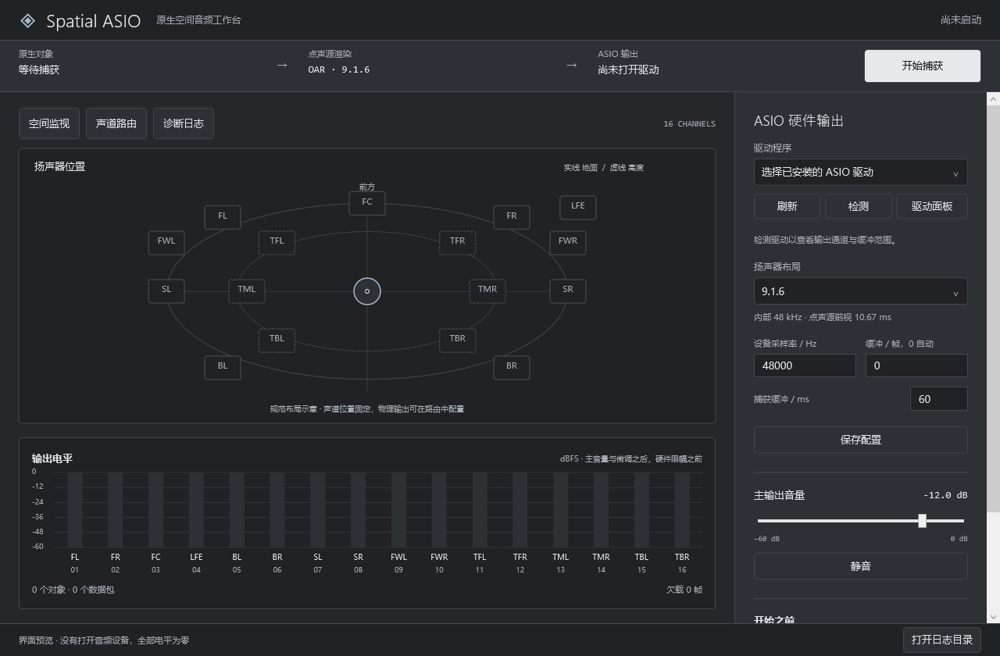

# Spatial ASIO

简体中文 Windows 空间音频工作台：**原生对象捕获 → OAR 点声源渲染 → ASIO 多声道输出**。



这是独立的新项目：保留项目作者的 Spatial Pip 捕获组件与本地开发的点声源/ASIO 实现，重新编写桌面界面、配置、队列、程序入口及安装流程。没有 spatial-audio-lab 的原有程序代码、驱动、电影播放器或解码器。依赖的第三方组件见 [许可清单](THIRD-PARTY-NOTICES.md)。

## 下载与运行

从 [Releases](https://github.com/hikari-taritsu/spatial-asio/releases) 下载 Windows x64 安装包。内含 .NET 10 桌面运行时、Python 3.12.10 与 Frida 17.23.3，运行时无需联网下载。

1. 安装声卡/音频接口厂商的 **64 位 ASIO 驱动**。
2. 安装并启动 Spatial ASIO，允许程序以管理员身份运行。
3. 选择 ASIO 驱动、扬声器布局，在“声道路由”中逐一核对物理输出。默认输出音量为 −12 dB。
4. 在**游戏实际使用的 Windows 播放设备**上启用 Windows Sonic，然后重新启动支持 Windows Spatial Audio 的游戏。游戏的播放端点与最终 ASIO 输出是两个不同的选择。
5. 点击“检查捕获兼容性”，通过后“开始捕获”。观察“正在接收对象”与输出电平。进程运行但没有空间对象时，界面明确显示等待。
6. 退出前点击“停止捕获”，让程序恢复音频宿主挂钩并关闭 ASIO。

不安装虚拟音频驱动。ASIO 设备自身仍需要厂商驱动。不会注入游戏进程，也不会自动修改 Windows 安全设置。

## 兼容范围与当前限制

**这是预览版本，不能宣称覆盖所有 Windows 10/11 系统。**

| 项目 | 范围 |
|---|---|
| 安装器/桌面目标 | Windows 10 2004+、Windows 11，原生 x64；本机验证，未做完整系统矩阵测试 |
| 原生捕获 | 仅允许已验证的 `audiodg.exe` 哈希；详见 [兼容性](docs/COMPATIBILITY.md) |
| 输入 | Windows 基础空间对象，48 kHz float32，最多 160 槽/流，最多 16 流 |
| 输出 | 一个 64 位 ASIO 驱动；声道映射、缓冲、采样率、总音量与逐声道微调 |
| 布局 | 9.1.6、7.1.4、7.1.2、5.1.4、5.1.2、5.1、2.0 |
| 渲染 | 按所选布局直接计算点声源增益；位置、增益、生命周期；512 帧前视 |
| 布局计算 | 七种布局分别以自己的扬声器集合构建声像几何，无 9.1.6 中间音频总线或固定折叠矩阵 |

不提供 WDM/WASAPI 输出、虚拟端点、ADM/WAV/电影文件输入、MAT/DTS/JOC/TrueHD 解码或其他渲染器。对象尺寸、扩散、个性化 HRTF 不在实现范围。ASIO 整数/浮点 PCM 受支持，DSD 不支持。非 48 kHz 输出采用线性采样率转换，48 kHz 是推荐路径。

一个音频宿主中的多个应用空间流会合并捕获；尚无逐游戏选择。不同流依靠时间戳近似对齐，不承诺跨应用逐样本同步。Windows 更新可能改变捕获 ABI；未知版本会拒绝捕获，不会猜测地址。受保护的音频宿主不支持。

## 声像与延迟

选择 7.1.4 时，对象位置直接得到 12 个输出增益；选择 5.1.2 时直接得到 8 个输出增益。5.x 的唯一环绕对覆盖房间后沿，使侧方对象在前方与环绕之间平移；7.x/9.x 保留独立侧方和后方。高度扬声器不存在时不再分配独立高度维度；立体声没有独立前后维度。床声道优先对应同名输出，缺失的非 LFE 声道按其位置在目标布局重新计算。对象不会进入 LFE；没有 LFE 输出时不自动实施低频管理。

9.1.6 保持此前本地点声源时间模型的回归结果；其他布局是该模型按目标几何的直接扩展，尚无逐布局 Dolby 官方参考对照，不宣称官方等价。圆形俯视图表示名义方位，高度层内缩用于区分；其半径不是房间距离校准参数。

捕获缓冲可设为 **8–500 ms**，新配置默认为 **32 ms**。先采用 ASIO 驱动推荐缓冲；降低捕获缓冲后观察欠载、迟到帧和丢包计数，出现增长则提高缓冲。已有设置在升级时保留。运行中可查看捕获缓冲、前视、输出排队、驱动报告延迟，以及每包渲染耗时。

0.1.1 移除了额外 20 ms 的最低启动积累，以两个 ASIO 周期准备输出；在捕获前完成驱动初始化，使用 MMCSS、事件唤醒和运行期间的 1 ms 定时请求。几何缓存、固定内存时间轴和未使用对象槽跳过减少工作量，界面遥测阻塞也不会阻塞音频生产线程。保留 512 帧前视和原有平滑规则。

本机 Dante Via 的 128 帧/48 kHz 测试与性能数据见 [验证记录](docs/VALIDATION.md)。缓冲估算和驱动报告均不等于从游戏动作到扬声器的声学端到端实测。

## 构建

需要 Windows x64、Visual Studio 2022 C++ Build Tools、Windows SDK、CMake 3.24+、.NET 10 SDK；创建安装包另需 Inno Setup 6.5+。

```powershell
powershell -ExecutionPolicy Bypass -File tools/Build.ps1 -Package
```

首次构建从 Python/PyPI 官方站点下载固定版本，校验 SHA-256。产物在 `dist/`，应用在 `dist/app/`。安装包保留用户配置于 `%LOCALAPPDATA%\SpatialASIO`，卸载不删除该目录。构建不依赖旧项目或商业音频软件。

## 许可与验证

项目代码采用 **GPL-3.0-only**；ASIO SDK 使用其 GPLv3 授权选项。第三方组件保留各自许可。没有商业 Dolby 二进制、参考音乐或游戏内容。

[测试说明](docs/VALIDATION.md) · [实现与来源](docs/PROVENANCE.md) · [兼容性](docs/COMPATIBILITY.md)

本项目并非 Dolby 官方产品，未经 Dolby 认证。点声源模型的局部参考一致性，不等于完整 Dolby 渲染器的一致性。
